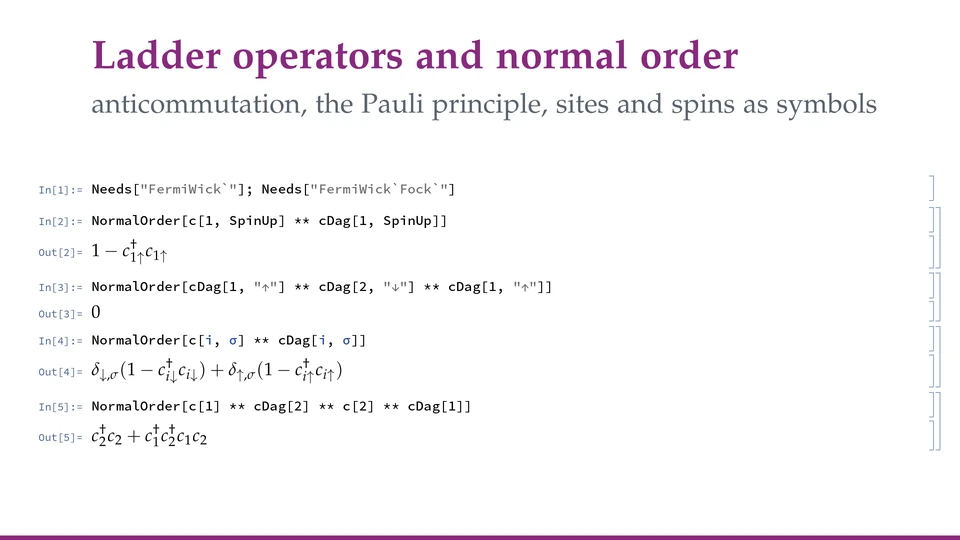
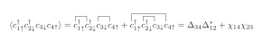

<p align="center">
  
</p>

<h1 align="center">FermiWick</h1>

<p align="center">
  <b>Wick's theorem, mean field, Gutzwiller projectors and exact diagonalisation for fermions</b><br>
  a Wolfram Language package for ladder operators, as symbols and as matrices
</p>

<p align="center">
  <a href="https://github.com/n4sd4q/FermiWick/releases/latest"></a>
  
  <a href="Tests"></a>
  
</p>

<p align="center">
  <a href="https://n4sd4q.github.io/FermiWick/"><b>Website</b></a>&nbsp;·
  <a href="https://n4sd4q.github.io/FermiWick/Showcase/FermiWick_Showcase.pdf"><b>Showcase</b></a>&nbsp;·
  <a href="https://n4sd4q.github.io/FermiWick/Documentation/FermiWick_Manual.pdf"><b>Manual</b></a>&nbsp;·
  <a href="Examples.wl"><b>Guided&nbsp;tour</b></a>&nbsp;·
  <a href="https://github.com/n4sd4q/FermiWick/wiki"><b>Wiki</b></a>&nbsp;·
  <a href="#installation"><b>Installation</b></a>
</p>

FermiWick lets you write fermion operators as on paper — ladder operators, a Hamiltonian, a product of any length, with
sites and spins as symbols — and does the algebra for you: normal order, spin operators recognized in the result,
expectation values by Wick's theorem in the state you assume, mean-field Hamiltonians, and the exact matrix of the same
expression, to solve a small cluster.

<p align="center">
  <a href="https://n4sd4q.github.io/FermiWick/Media/demo.mp4"></a>
</p>

## What it does

- **Ladder operators as on paper.** `c[i, s]` and `cDag[i, s]`, with sites and spins as symbols, or modes with any
  labels: orbitals, momenta, labels of your own; products, sums, "+ h.c.".
- **Normal order, spins recognized.** Products in normal order, the local operators (densities, spins, double
  occupancy) kept compact, and the operators on several sites recognized: $\mathbf S_i\cdot\mathbf S_j$, the
  chirality, operators of your own.
- **Wick's theorem in the state you assume.** Expectation values of products of any length in a Gaussian state declared
  by its symmetries — spin rotations, charge, time reversal — or by rules, with normal and anomalous contractions.
- **Mean field of any order.** The Hartree–Fock–Bogoliubov Hamiltonian of an operator of four, six or more fermions,
  with its constant; Gutzwiller projectors, and projected expectation values in the Gutzwiller approximation.
- **Exact diagonalisation.** The same expressions as sparse matrices on a Fock space or a symmetry sector: spectra,
  ground states, correlations, Green's functions. A Hubbard ring of twelve sites at half filling, 853 776 states, is
  written as a matrix in about four seconds.
- **LaTeX.** Any result, and Wick's theorem written out with its contractions drawn.

Sites and spins are symbols, so a result holds on any lattice; with numbers for the sites, the same expression is a
matrix, and every symbolic result can be checked exactly.

<details>
<summary>Everything it does, with the names of the functions</summary>

**Operators**
- `c[i, s]`, `cDag[i, s]`, `SpinUp`, `SpinDown`, `$Spins`; local operators `nOp`, `nTotOp`, `SzOp`, `SpOp`, `SmOp`, `DOp`, `B`, `Bdag`, `SpinOperator`;
  `SdotS`, `SdotScrossS`, `EmptyProjector`, `SingleOccupationProjector`; operators of your own with `DefineOperator`;
  modes with any labels with `DeclareModeLabels`
- products `**` and `·` (normal-ordered), `NormalOrder`, `OperatorCommutator`, `OperatorAnticommutator`,
  `ToSpinChargeBasis`, `ToLadderBasis`, `GroupLocalOperators`, `OperatorCoefficients`, `CleanDeltas`
- `Dagger`, `PlusHC`, `HermitianOperatorQ`

**States, Wick and mean field**
- `GaussianState` (from symmetries `"SpinRotation"`, `"SpinRotationZ"`, `"Charge"`, `"TimeReversal"`, or from rules),
  `ContractionTable`, `SpinSingletState`, `GeneralState`, `StateSelect` with `LocalPairQ` and `AnomalousPairQ`,
  `Contraction`, `$State`
- `WickVEV` (options `"MaxOrder"`, `"NormalOrder"`), `VerifyNormalOrder`, `MeanField`

**LaTeX**
- `ToTeX`, `WickPairings`, `WickTeX`

**Gutzwiller** (``FermiWick`Gutzwiller` ``)
- `GutzwillerProjector`, `LocalSandwich`, `GutzwillerVEV`, `GutzwillerSimplify`

**Lattices**
- `DefinePeierlsHopping`, `DefineFlux`

**The package**
- `$FermiWickVersion`, `FermiWickUpdateCheck`, `$FermiWickUpdateCheck`

**Matrices** (``FermiWick`Fock` ``)
- `FockSpace`, `FockSector`, `ModeIndex`, `FockMatrix`, `FockExpectation`, `OccupationBasis`, `BasisState`, `StateToKet`
- `LowestStates`, `LehmannGreen`, `GreenMatrix`, `SpinSquared`, `ParticleHoleOperator`, `TimeReversal`, `SectorBlock`
- `ClearFockCache`, `$FockFullLimit`, `$FockDenseLimit`

</details>

**Scope.** Spin-½ fermions, and modes with any labels; exact symbolic expressions, and matrices on clusters of up to
about a million states. Bosons and lattice symmetries (momentum, point group) are outside its scope.

## A first example

One session, from the ladder operators to a solved model (the matrices are a module of their own):

```mathematica
Needs["FermiWick`"]; Needs["FermiWick`Fock`"]
```

**Ladder operators.** `c[i, s]` annihilates and `cDag[i, s]` creates a fermion on site `i` with spin `s`; `**`
multiplies in the order written, and `NormalOrder` brings the creators to the left:

```mathematica
NormalOrder[c[1, SpinUp] ** cDag[1, SpinUp]]
```

$$1-c^\dagger_{1\uparrow}c_{1\uparrow}$$

**Spins.** Products of ladder operators are read back as spins and densities, with the sites left as symbols:

```mathematica
ToSpinChargeBasis[1/2 Sum[cDag[i, s] ** c[i, r] ** cDag[j, r] ** c[j, s], {s, $Spins}, {r, $Spins}]]
```

$$\mathbf S_{i}\cdot\mathbf S_{j}+\frac{1}{4} n_{i}n_{j}$$

**A model, solved exactly.** The Hubbard dimer, written as on paper, is a matrix on the sector of two electrons with
$S^z=0$; its spectrum:

```mathematica
H = -t Sum[PlusHC[cDag[1, s] ** c[2, s]], {s, $Spins}] + U Sum[nOp[i, SpinUp] ** nOp[i, SpinDown], {i, 2}];
Eigenvalues[Normal[FockMatrix[H, FockSector[FockSpace[{1, 2}], "N" -> 2, "Sz" -> 0]]]]
```

$$\left\\{0,U,\frac{1}{2} \left(U-\sqrt{16 t^2+U^2}\right),\frac{1}{2} \left(\sqrt{16 t^2+U^2}+U\right)\right\\}$$

**Expectation values.** By Wick's theorem, in a Gaussian state: `SpinSingletState[]` is invariant under spin rotations,
with hopping amplitudes $\chi_{ij}$. The energy of the dimer in it:

```mathematica
WickVEV[H, SpinSingletState[]]
```

$$-2 t \chi_{12}^{\ast}-2 t \chi_{12}+\frac{U}{2}$$

**The state you assume.** A state is declared by its symmetries, and they decide what survives: the scalar chirality
$\mathbf S_1\cdot(\mathbf S_2\times\mathbf S_3)$, a product of six fermions, needs a state that breaks time reversal.

```mathematica
{WickVEV[SdotScrossS[1, 2, 3], GaussianState[{"SpinRotation", "Charge"}]],
 WickVEV[SdotScrossS[1, 2, 3], GaussianState[{"SpinRotation", "Charge", "TimeReversal"}]]}
```

$$\left\\{\frac{3}{2} i \chi_{13} \chi_{12}^{\ast} \chi_{23}^{\ast}-\frac{3}{2} i \chi_{12} \chi_{23} \chi_{13}^{\ast},0\right\\}$$

**Mean field.** The Hartree–Fock–Bogoliubov Hamiltonian of any operator: the Hubbard interaction of a site, in a state
with magnetization $m$ along $z$.

```mathematica
magnetic = GaussianState[{"SpinRotationZ", "Charge"}, "Filling" -> 1/2, "Magnetization" -> m];
ToSpinChargeBasis[MeanField[U nOp[1, SpinUp] ** nOp[1, SpinDown], magnetic]]
```

$$m^2 U-2 m S^z_{1} U+\frac{1}{2} n_{1} U-\frac{U}{4}$$

**LaTeX.** Any result in LaTeX; `WickTeX` writes Wick's theorem out, with the contractions drawn:

```mathematica
WickTeX[cDag[1, SpinUp] ** cDag[2, SpinDown] ** c[3, SpinDown] ** c[4, SpinUp], SpinSingletState["Pairing" -> Δ]]
```

<p align="center"></p>

**Next.** The [guided tour](Examples.wl) builds all this up step by step; the
[wiki](https://github.com/n4sd4q/FermiWick/wiki) has the recipes (writing operators, declaring a state, mean field,
exact diagonalisation, LaTeX); the [showcase](https://n4sd4q.github.io/FermiWick/Showcase/FermiWick_Showcase.pdf) goes
through the physics, and the [manual](https://n4sd4q.github.io/FermiWick/Documentation/FermiWick_Manual.pdf) describes
every function. ``?FermiWick`*`` lists the functions and `?Name` explains each one.

## Installation

Install the paclet of the latest [release](https://github.com/n4sd4q/FermiWick/releases) once:

```mathematica
PacletInstall["https://github.com/n4sd4q/FermiWick/releases/download/v0.4.0/FermiWick-0.4.0.paclet"]
```

and load it in every session:

```mathematica
Needs["FermiWick`"]
Needs["FermiWick`Gutzwiller`"]   (* Gutzwiller projectors, when needed *)
Needs["FermiWick`Fock`"]         (* matrices and exact diagonalisation, when needed *)
```

There are no dependencies; the package needs Mathematica 13.0 or later. The guided tour, a notebook to run cell by cell,
comes with the paclet:

```mathematica
NotebookOpen[PacletObject["FermiWick"]["AssetLocation", "Examples"]]
```

In a notebook the package looks for a newer release on GitHub once a day; `$FermiWickUpdateCheck = False` before `Needs`
turns this off ([`SECURITY.md`](SECURITY.md) says more). Other ways to install, and updating: the wiki's
[Installation](https://github.com/n4sd4q/FermiWick/wiki/Installation) page.

## Documentation

| Document | Contents |
|---|---|
| [Website](https://n4sd4q.github.io/FermiWick/) | the package at a glance: what it does, the first example, installation, the documents |
| [Guided tour](Examples.wl) | a notebook to run cell by cell, from the ladder operators to a solved model (`FermiWick/Examples.nb` in the paclet) |
| [Wiki](https://github.com/n4sd4q/FermiWick/wiki) | practical guides: writing operators, declaring a state, mean field, exact diagonalisation, LaTeX; a FAQ |
| [Showcase](https://n4sd4q.github.io/FermiWick/Showcase/FermiWick_Showcase.pdf) (PDF) | the package step by step, from the anticommutation relations to the parton mean field of a chiral spin model, the Brinkman–Rice transition and Hubbard clusters solved exactly |
| [Manual](https://n4sd4q.github.io/FermiWick/Documentation/FermiWick_Manual.pdf) (PDF) | every function, option and convention, with examples |
| [Changelog](CHANGELOG.md) | what changed in each version |

Every output printed in the documents is computed by the code shown before it.

<details>
<summary>Conventions in brief</summary>

* `c[i, s]` annihilates a fermion on site `i` with spin `s` (`SpinUp`, `SpinDown` or a symbol). Different symbolic sites
  are different sites.
* `a ** b` is the product in the given order; `a · b` (`\[CenterDot]`) is the product in normal order, with every
  `cDag` to the left of every `c`.
* Contractions in spin channels: $\langle c^\dagger_{i\sigma}c_{j\sigma'}\rangle=\chi_{ij}\delta_{\sigma\sigma'}+\sum_a\chi^a_{ij}\sigma^a_{\sigma'\sigma}$,
  $\langle c_{i\sigma}c_{j\sigma'}\rangle=\sum_\tau(\Delta_{ij}\delta_{\sigma\tau}+\sum_a\Delta^a_{ij}\sigma^a_{\sigma\tau})\epsilon_{\tau\sigma'}$, $\epsilon_{\uparrow\downarrow}=1$;
  $\chi_{ji}=\chi_{ij}^{\ast}$, $\chi^a_{ii}=\langle S^a_i\rangle$, $\Delta_{ji}=\Delta_{ij}$, $\Delta^a_{ji}=-\Delta^a_{ij}$.

</details>

## Checks

The tests (`math -script Tests/RunTests.wls`, 94 tests) check the algebra and the states, and the symbolic engine
against the matrices: `WickVEV` and `MeanField` give the exact values in random Gibbs states of quadratic Hamiltonians
with pairing, and the matrices agree with the Jordan–Wigner construction and with exact solutions of Hubbard clusters.
`sh Development/check_docs.sh` runs the code of the showcase, the manual, the guided tour, the README and the wiki again,
in fresh kernels, and compares it with what they print.

## Related software

[SNEG](https://github.com/rokzitko/sneg) (Žitko, Comput. Phys. Commun. **182**, 2259 (2011)) is the closest relative:
second quantization in Mathematica, with bosons, Majorana fermions, arbitrary spin and exact diagonalization; its Wick
contractions are taken in the vacuum or in the Fermi sea. [QuantumAlgebra.jl](https://github.com/jfeist/QuantumAlgebra.jl)
(Julia) handles equations of motion and cumulant expansions; [wick&d](https://github.com/fevangelista/wickd),
[SeQuant](https://github.com/ValeevGroup/SeQuant), [pdaggerq](https://github.com/edeprince3/pdaggerq),
[drudge](https://github.com/tschijnmo/drudge) and SymPy's
[secondquant](https://docs.sympy.org/latest/modules/physics/secondquant.html) are built for the coupled-cluster equations
of quantum chemistry. FermiWick adds Wick's theorem in a Gaussian state that you declare, with anomalous contractions,
the mean field of any order, Gutzwiller projectors, and the same operators as exact matrices.

## Citing

If you use FermiWick in published work, please cite it as described in [`CITATION.cff`](CITATION.cff).

## License

Released under the [GNU General Public License, version 3 or later](LICENSE), with two additional terms
([`NOTICE`](NOTICE)): the attribution to the author must be kept, and modified versions must say that they are modified,
by whom and when. Author: Nazzareno Africani (SISSA).
